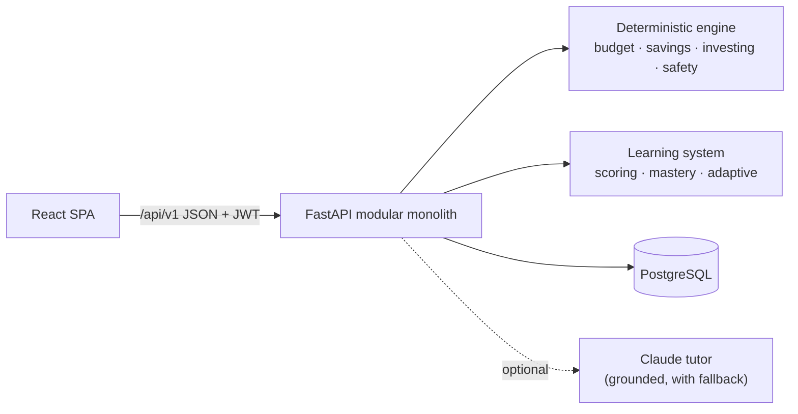

# RupeeRise

**Learn Money. Make Smarter Moves.**

RupeeRise is an interactive financial-literacy platform for students in Classes 7–12 and age 18, built for under-served communities around Hyderabad. Students live through realistic, persona-led money situations with **fictional rupees**: they make decisions, a deterministic engine calculates the consequences, they get a clear explanation, and they try again. Understanding is assessed concept by concept, the next activity adapts to it, and NGO educators see where their class needs support.

> Built for **IIIT Hyderabad Megathon 2026 · Vanguard** problem statement *"Empowering the Next Generation Through Financial Literacy."* Education only. RupeeRise never recommends real financial products, and simulations are assumptions, not promises.

## What students can do

| Pillar | Interactive experiences |
|---|---|
| **Plan & Budget** | Split a monthly allowance, stipend or wage across needs, wants and savings; a surprise expense (or income drop) tests the plan; see where the money came from and retry. 4 persona scenarios. |
| **Save & Manage** | Split savings between a goal and an emergency fund, pick where to keep it, absorb an emergency mid-plan, see month-by-month balances and simple vs compound interest. 3 scenarios + compounding explorer. |
| **Understand Investing** | Allocate fictional money across fictional assets, choose a time horizon, live through a market fall, and see 1,000 possible futures, loss probability by horizon and why diversification matters. Scored on reasoning, not luck. 3 scenarios + explorer. |
| **Stay Financially Safe** | Judge realistic SMS/WhatsApp/UPI messages (scams *and* genuine ones), spot red flags, choose a safe action, get an explanation per message. 3 challenge sets, 14 messages. |

Plus: four relatable personas (Meera, Lakshmi, Arjun, Imran), a starting check and final check, module quizzes with explanations for every option, misconception detection, transparent adaptive recommendations, badges kept separate from understanding scores, an optional grounded AI tutor with deterministic fallback, English/हिन्दी/తెలుగు interface, and accessibility settings.

**Educators / NGOs** create a class, share a 6-character join code and get participation, module completion, concept-level mastery, starting-vs-final comparison, topics needing support and the most common misconceptions. Students are shown by nickname only.

## New in v2

| Feature | What it is |
|---|---|
| Age-adaptive stages | Explorer (7–8), Builder (9–10), Future Planner (11–12), Investor Sandbox (18); eligibility enforced by the server |
| Fictional reward wallet | Append-only ledger; rewards follow understanding and safe choices, never guessing |
| Portfolio Quest | Persisted fictional portfolio with seeded price paths, idempotent trades and a capped one-way wallet transfer |
| Learning score and levels | Transparent 0–100 score and five levels, gated on understanding, never money |
| ₹500 Money Lab, Banking Explorer, reflections | Planning under a surprise; sourced banking facts with a last-verified date; multiple-choice reflection |
| Public demo | `/journey-demo` (local demo data only) |

Status of each item is in [docs/redesign/audit-and-plan.md](docs/redesign/audit-and-plan.md) and [docs/limitations.md](docs/limitations.md).

## Architecture at a glance



Details: [docs/architecture.md](docs/architecture.md) · [docs/database-design.md](docs/database-design.md) · [docs/api-contracts.md](docs/api-contracts.md)

## Tech stack

| Layer | Choice |
|---|---|
| Frontend | React 19, TypeScript, Vite, React Router, Tailwind CSS v4, shadcn-style components on Radix, Lucide, Motion, Recharts |
| Backend | Python 3.12, FastAPI, Pydantic v2, SQLAlchemy 2, Alembic, bcrypt, PyJWT |
| Database | PostgreSQL (17 locally; 15+ supported) |
| AI (optional) | Anthropic Python SDK, `claude-opus-5-5` by default, deterministic fallback |
| Testing | Pytest, Vitest, React Testing Library, Playwright |
| CI/CD | GitHub Actions; Docker images for API and web |

## Quick start (local)

Prerequisites: Python 3.12 with [uv](https://docs.astral.sh/uv/), Node 20+, PostgreSQL running locally.

```bash
# 1. Database
createdb rupeerise

# 2. Backend  →  http://localhost:8000/api/docs
cd backend
cp .env.example .env            # edit if your Postgres needs a user/password
uv sync
uv run alembic upgrade head
uv run python -m app.seed --demo # content + clearly labelled sample class
uv run uvicorn app.main:app --reload --port 8000

# 3. Frontend  →  http://localhost:5173   (new terminal)
cd frontend
npm install
npm run dev
```

Sample accounts created by `--demo` (local development only): `demo.student` and `demo.educator`, password `rupeerise-demo`. To register your own educator account, an operator creates an organisation and a one-time invitation, then you paste the token on the educator sign-up tab:

```bash
uv run python -m app.admin create-org "My NGO"
uv run python -m app.admin create-invite --org "My NGO"   # prints the token once
```

Answer keys are not in the repository (see [docs/content-privacy.md](docs/content-privacy.md)). Without the private bundle, development runs with clearly labelled placeholder keys.

Optional AI tutor: `uv sync --group ai`, then set `RUPEERISE_ANTHROPIC_API_KEY` in `backend/.env`. Without it, the tutor answers from the verified concept glossary and the student's own simulation feedback.

Docker alternative: see [docs/deployment.md](docs/deployment.md) (`docker compose up --build`).

## Environment variables

All backend settings use the `RUPEERISE_` prefix; see [`backend/.env.example`](backend/.env.example), [`frontend/.env.example`](frontend/.env.example) and [`.env.example`](.env.example) (Docker). Production refuses to start with the default secret key, insecure cookies or missing answer keys. Never commit `.env` files.

## Testing

```bash
createdb rupeerise_test && createdb rupeerise_e2e   # once
cd backend && uv run pytest                          # 417 tests: engine, ledger, portfolio, learning, security, API on real Postgres
cd frontend && npm test                              # 31 unit/component tests
cd frontend && npx playwright install chromium && npm run test:e2e   # 22 end-to-end journeys incl. axe accessibility scan
```

More in [docs/testing.md](docs/testing.md).

## How the simulations calculate outcomes

- Pure Python engine (`backend/app/engine`), **no LLM** in any calculation. Money uses `Decimal` rounded to paise; interest is credited monthly in whole paise like a ledger.
- Every session has a reproducible seed (`student:scenario:attempt`) that picks the surprise event or market path, so results can be replayed and audited.
- Scores follow published rubrics (e.g. budgeting: needs covered 40, savings habit 25, wants in check 15, goal on track 20; then 70% plan + 30% handling of the surprise). Investing scores reward diversification, matching risk to the time horizon and calm responses to falls, and are **identical across market paths**, so luck can't inflate them.

## How learning is assessed

- A 12-question **starting check** and a parallel **final check** (one attempt each, so comparisons stay fair) plus a 5-question quiz per module.
- Every wrong option is tagged with a **misconception** ("saving only what is left over", "believing a PIN is needed to receive money", …) and explained.
- **Concept mastery** = smoothed, weighted evidence from answers and simulation decisions. Quiz retakes count 1/n; answers faster than 2 seconds count a quarter and are flagged. Badges and completion never change mastery.
- **Adaptive rules** pick one next activity with a human-readable reason (weakest pillar → difficulty matched to mastery → persona preferred → quiz → final check).

## Documentation

| Doc | Purpose |
|---|---|
| [requirements.md](docs/requirements.md) | Requirement classification and traceability matrix |
| [architecture.md](docs/architecture.md) | Components, pipelines, rubrics, ADRs (Mermaid diagrams) |
| [database-design.md](docs/database-design.md) | ER diagram, constraints, privacy design |
| [security.md](docs/security.md) · [content-privacy.md](docs/content-privacy.md) | Security model, limits, residual risks |
| [api-contracts.md](docs/api-contracts.md) · [openapi.json](docs/openapi.json) | Stable API contract |
| [development-roadmap.md](docs/development-roadmap.md) | Milestones and tracks |
| [team-ownership.md](docs/team-ownership.md) · [team-handoff/](docs/team-handoff/) | Who owns what; per-member briefs |
| [testing.md](docs/testing.md) · [deployment.md](docs/deployment.md) | How to verify and ship |
| [limitations.md](docs/limitations.md) | What is not done yet, stated plainly |

## Privacy

RupeeRise stores a nickname, username, password hash, grade band, language and learning preferences, plus fictional simulation data and answers. No email, phone, address, school ID, Aadhaar or real financial data. Students can delete their account and all learning data from Settings. Educators see only their own organisation's classes.

## Team

Five-member team for IIIT Hyderabad Megathon 2026. Ownership and branches: [docs/team-ownership.md](docs/team-ownership.md).
