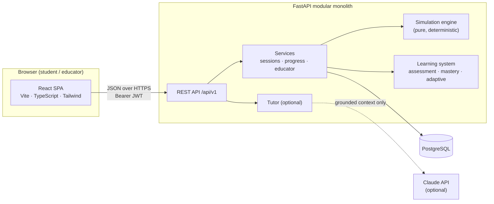
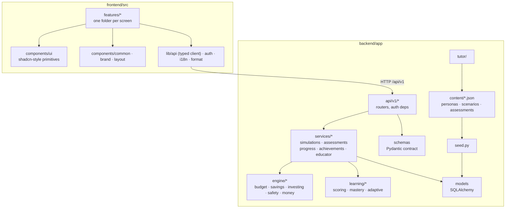
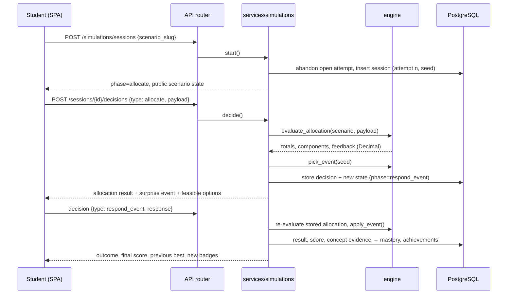
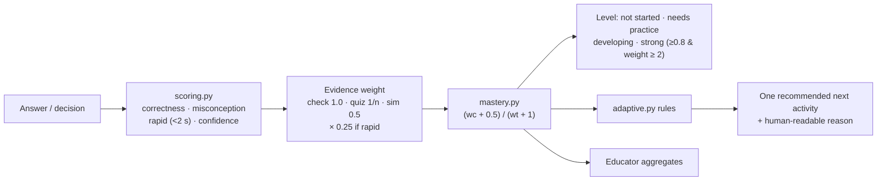
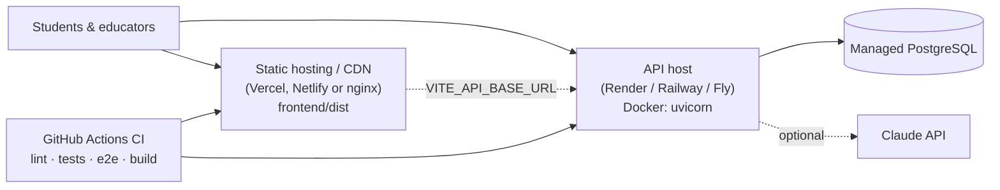

# Architecture

RupeeRise is a **modular monolith**: one FastAPI service with strict internal module boundaries, one PostgreSQL database and one React single-page app. At ~1,500 students this is far simpler to run, test and change than microservices, and the module boundaries let five people work in parallel.

## 1. High-level architecture

## 2. Component architecture

**Dependency rules** (enforced by review):
- `engine/` imports nothing from the app except `engine.money`. No DB, HTTP or LLM.
- `learning/` may import `engine.money` and `models` types; `adaptive.py` and `scoring.py` are pure.
- `services/` orchestrate engine + learning + DB. Routers stay thin.
- Frontend features talk to the backend only through `lib/api/endpoints.ts`.

## 3. Financial simulation pipeline

Design decisions:
- **Deterministic & reproducible.** Seeds are `crc32(student:scenario:attempt)`. Market paths are fixed tables; the Monte Carlo fan uses a seeded RNG. Same inputs → same outputs.
- **Money is `Decimal`** quantised to paise with `ROUND_HALF_UP`. Interest is credited in whole paise each month like a ledger. Floats are only used inside the illustrative Monte Carlo and rounded to rupees.
- **Server is authoritative.** Later steps re-run the engine on the *stored raw decision*; client-sent numbers are never trusted. Each phase accepts exactly one decision type, so sessions can't reach inconsistent states (409 `invalid_transition`).
- **No LLM in calculations.** The tutor only explains results the engine already produced.

### Scoring rubrics (transparent to students)

| Simulation | Components |
|---|---|
| Budget (planning) | Needs covered 40 · Savings habit 25 (≥20% savings, buffer counts half) · Wants in check 15 (≤30% full, 0 at ≥60%) · Goal on track 20 |
| Budget (final) | 70% planning + 30% surprise handling (best feasible: cut wants > mix > use savings > borrow) |
| Savings | Goal reached 40 · Surprise handled without touching goal 30 · Emergency habit 15 · Account choice 15 |
| Investing | Diversification 25 · Risk matches horizon 35 · Avoided concentration 15 · Calm response to a fall 25. **Never depends on which market path occurred.** |
| Safety (per message) | Correct verdict 50 · Red-flag F1 30 · Safe action 20 |

## 4. Learning and assessment pipeline

**Mastery is separate from completion and badges.** Completing an activity earns progress and maybe a badge; only answers and decision evidence move mastery.

**Not rewarding guessing:** module-quiz retakes are weighted 1/n; answers under 2 seconds count ×0.25 and an attempt with ≥50% rapid answers is flagged; the starting and final checks are one-shot so pre/post comparisons stay fair.

**Adaptive rules** (`learning/adaptive.py`, in priority order):
1. Finish onboarding → 2. take the starting check → 3. weakest incomplete module: no simulation yet → scenario at difficulty 1 (<50% mastery), 2 (<80%) or 3; persona match preferred; misconception named in the reason; simulation done → module quiz → 4. all modules → final check → 5. practise weakest concept or try an untried challenge.

## 5. Security & privacy

- Passwords: bcrypt (12 rounds). Sessions: HS256 JWT bearer tokens (12 h). Production refuses to start with the default secret or invite code.
- Roles: `student`, `educator`, `admin`. Educator endpoints require an organisation and only return cohorts of that organisation (404 for others, so IDs can't be probed).
- Data minimisation: nickname, username, grade band, language, preferences. No email, phone, school ID, Aadhaar, or real financial data.
- Students can delete their account; all learning data cascades.
- Consistent error envelope `{"error": {"code", "message", "field?"}}`; unexpected errors are logged server-side and return a generic message.

## 6. Deployment architecture

See [deployment.md](deployment.md).

## 7. Architectural decision log

| # | Decision | Alternatives | Why |
|---|---|---|---|
| ADR-1 | Modular monolith | Microservices | Team of 5, 48-hour build, ~1,500 users |
| ADR-2 | Synchronous SQLAlchemy 2 | Async ORM | Simpler code/tests; threadpool handles target load |
| ADR-3 | Content as versioned JSON seeded into DB by slug | Hard-coded Python / CMS | Translators & educators can edit; FK integrity for attempts |
| ADR-4 | Deterministic engine with Decimal | Float maths / LLM-generated outcomes | Correctness, reproducibility, testability |
| ADR-5 | JWT in `localStorage` | httpOnly cookies | Simple cross-origin deployment for a hackathon; see limitations |
| ADR-6 | Hand-written shadcn-style components on Radix primitives | Full shadcn CLI / MUI | No generator dependency, small bundle, full design control |
| ADR-7 | Optional Claude tutor via official SDK, deterministic fallback | Required LLM | Platform works offline from AI; no hallucinated numbers |
