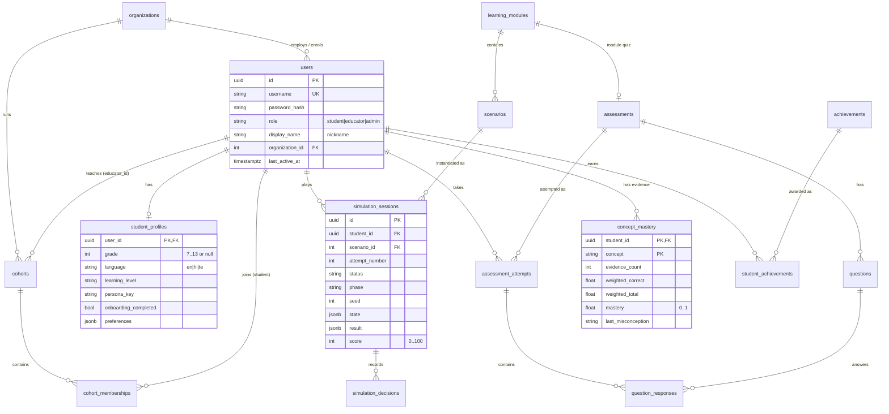

# Database Design

PostgreSQL 15+ (developed on 17). Schema is defined in `backend/app/models/__init__.py` and versioned with Alembic (`backend/alembic/versions`). **Never edit an applied migration; add a new one** (`uv run alembic revision --autogenerate -m "..."`, then review the file).

## Entity relationship diagram

## Tables

| Group | Table | Purpose | Key constraints |
|---|---|---|---|
| Identity | `organizations` | NGOs / schools | unique `name`; `kind` check |
| | `users` | All accounts | unique `username`; `role` check; org `SET NULL` on delete |
| | `student_profiles` | Learning preferences (1:1 user) | `grade`, `language`, `learning_level` checks; cascade on user delete |
| | `cohorts` | Classes with 6-char `join_code` | unique `join_code`; cascade with org |
| | `cohort_memberships` | Student ↔ cohort | composite PK |
| Content (seeded) | `learning_modules` | Four pillars | unique `slug`; `pillar` check |
| | `scenarios` | Simulation configs (`config` JSONB, `stages` JSONB) | unique `slug`; `kind` (incl. `money_lab`), `difficulty 1–3` checks |
| | `assessments`, `questions` | Checks and quizzes; options JSONB with correctness, misconception, explanation | unique slugs; `kind` check |
| | `achievements` | Badge catalogue | unique `slug` |
| Learning evidence | `simulation_sessions` | One attempt at a scenario | unique (`student`, `scenario`, `attempt_number`); `status` & `score 0–100` checks |
| | `simulation_decisions` | Raw decisions per step (audit + recomputation) | unique (`session`, `step`) |
| | `assessment_attempts` | One attempt at an assessment | unique (`student`, `assessment`, `attempt_number`); `score_pct 0–100` |
| | `question_responses` | Answer, confidence, response time, misconception | unique (`attempt`, `question`); confidence check |
| | `concept_mastery` | Aggregated evidence per concept | PK (`student`, `concept`); `0 ≤ mastery ≤ 1`; `weighted_correct ≤ weighted_total` |
| | `student_achievements` | Earned badges | PK (`student`, `achievement`) |

## Privacy by design

- **Personal data is minimal and isolated** in `users` / `student_profiles`. No email, phone, address, school ID or government ID columns exist.
- **Fictional financial data is separate**: sessions, decisions and results reference only `student_id` and contain fictional rupees. They are not linked to any real bank or payment data (none is collected).
- **Right to erasure:** `DELETE /api/v1/students/me` deletes the user; every learning table uses `ON DELETE CASCADE`.
- **Educator visibility** is limited to aggregates and nicknames of students in cohorts of their own organisation.

## Seeding and sample data

- `uv run python -m app.seed` upserts content by slug (safe to re-run; used in Docker start-up).
- `uv run python -m app.seed --demo` adds **sample data** clearly labelled "(sample)" and an organisation named *Sample NGO (demo data)*. Sample students play real simulations through the services, so dashboards show computed numbers. Refused when `RUPEERISE_ENV=production`.

## Scale notes (~1,500 students)

Each student generates roughly 30–60 sessions and ~100 question responses over a programme, i.e. well under 1 M rows total. Foreign keys used in filters are indexed (`student_id` on sessions/attempts/responses/decisions). Educator overviews use set-based aggregate queries per cohort rather than per-student loops.
